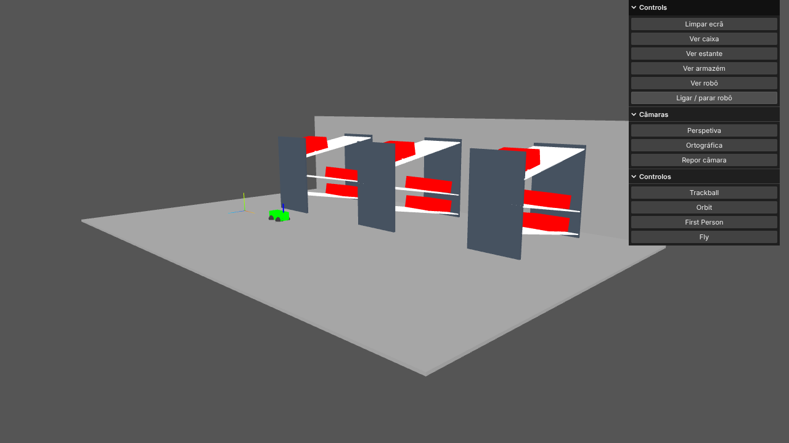

# Armazém 3D (Three.js / WebGL)

Cena 3D interativa de um armazém com estantes inclinadas, caixas e um robô móvel, construída com **Three.js** e programação orientada a objetos em JavaScript (módulos ES). Corre diretamente no browser, sem *build*.



> Projeto académico (Licenciatura em Engenharia Informática, ISPGAYA), desenvolvido em dupla com Samuel Gomes. Esta versão inclui correções e melhorias feitas depois da entrega (ver abaixo).

## O que tem

- **Modelação por classes**: `MyBox` (caixa aberta), `Estante` (3 andares inclinados com caixas), `Warehouse` (3 estantes, chão, parede e 3 focos de luz) e `Robot` (corpo, rodas e braço), todas a estender `THREE.Object3D` e compostas entre si.
- **Duas câmaras**: perspetiva e ortográfica.
- **Quatro modos de navegação**: Trackball, Orbit, First Person e Fly.
- **Animação**: o robô percorre o corredor, com velocidade independente da taxa de atualização do ecrã.
- **Painel de controlo** (`lil-gui`) para mostrar/limpar objetos, trocar de câmara e de controlo e ligar o robô.

## Como correr

Os módulos ES não funcionam com duplo clique (`file://`); usa um servidor local:

```bash
python -m http.server 8000
# abre http://localhost:8000
```

No painel: **Ver armazém** → **Ver robô** → **Ligar / parar robô**. Experimenta *Orbit* para rodar à volta da cena.

O Three.js (versão fixa `0.161.0`) é carregado por CDN através de um `importmap`, por isso é necessária ligação à Internet.

### Publicar no GitHub Pages
No repositório: *Settings → Pages → Deploy from a branch → `main` / root*. O site fica em `https://<utilizador>.github.io/<repositorio>/`.

## Estrutura

```
index.html        Página e importmap do Three.js
src/Webgl.js      Renderer, cena, luzes, câmaras, controlos e ciclo de animação
src/MyGui.js      Painel de controlo e lógica do robô
src/Warehouse.js  Armazém (estantes, chão, parede, focos)
src/Estante.js    Estante de 3 andares inclinados com caixas
src/Caixa.js      Caixa aberta
src/Robot.js      Robô
```

## O que foi melhorado após a entrega

| Problema na versão entregue | Correção |
|---|---|
| "Limpar ecrã" removia também as **luzes** da cena (objetos seguintes ficavam pretos) | Objetos da aplicação vivem num grupo próprio; as luzes são permanentes |
| Dois ciclos de render por frame (um no HTML, outro na classe) e `getDelta()` chamado duas vezes, o que falseava a velocidade dos controlos | Um único ciclo com `renderer.setAnimationLoop` |
| A câmara olhava para a origem em vez de para o armazém (o alvo dos controlos nunca era definido) | Alvo definido nos controlos Trackball/Orbit |
| O botão "Reset" colocava a câmara numa posição diferente da inicial | Posição inicial única, reutilizada no reset |
| Sem *resize*: a imagem deformava ao redimensionar a janela | Atualização de câmaras e renderer no evento `resize` |
| Robô movia-se 1 mm por *frame* (mais rápido em ecrãs de 144 Hz) | Movimento por tempo decorrido (mm/s) |
| Aviso de *deprecation* (`useLegacyLights`) | Migração para a iluminação fisicamente correta |
| Laterais das estantes a preto puro e faces sobrepostas nas caixas (*z-fighting*) | Cor de aço escuro e geometria sem sobreposição |
| Parâmetros não usados, chaves duplicadas e `console.log` de debug | Limpeza e comentários em português |

## Próximos passos

- Colisões do robô e trajetos configuráveis.
- Sombras (`castShadow`/`receiveShadow`) e texturas.
- Carregar a disposição do armazém a partir de um ficheiro JSON.
